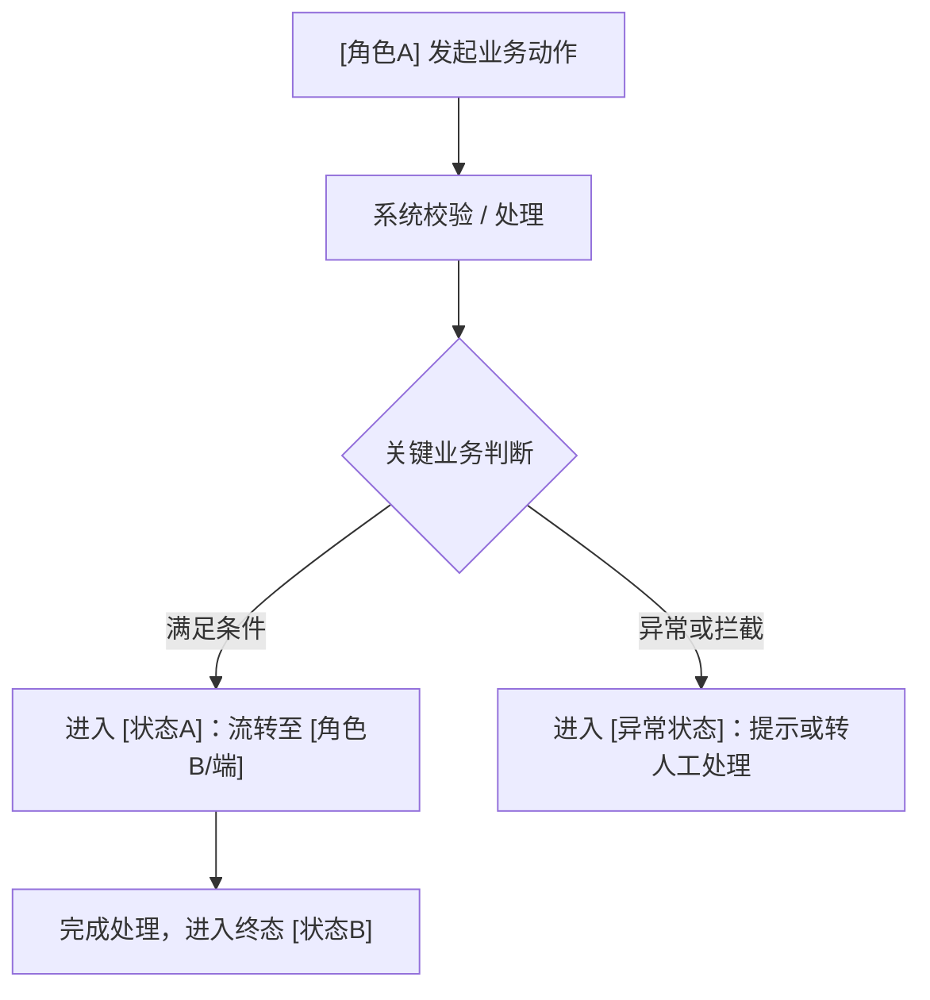

# [项目 / 模块名称] 产品需求文档

# 一、文档信息与背景范围

| 项目 | 内容 |
| :--- | :--- |
| 文档版本 | [V1.0] |
| 文档状态 | [草稿 / 评审中 / 已确认] |
| 更新日期 | [YYYY-MM-DD] |
| 产品负责人 | [姓名 / 待补充] |
| 涉及团队 | [产品 / UI / 前端 / 后端 / 测试] |
| 原型 / UI 链接 | [链接地址 / 暂无（全篇仅在此保留一次）] |
| 关联文档 | [关联历史 PRD 名称及章节 / 无] |

**版本修改记录**

| 版本号 | 修改日期 | 修改内容与涉及章节 | 修改人 |
| :--- | :--- | :--- | :--- |
| [V1.0] | [YYYY-MM-DD] | 初始创建完整需求方案 | [姓名] |

**项目背景与范围**

- **需求背景**：[1~2 句话说明解决什么实际业务问题，不写行业空话]。
- **本次范围**：[一句话概括本次涉及的角色、端口与核心闭环能力]。
- **不在本次范围**：[仅列容易被误认为本期包含、实则不做的事项；无则删除本行]。

---

# 二、全局业务流程与多端全景

## 2.1 核心业务流程图

[多角色优先按泳道或角色分组体现交接节点，包含主干路径与影响状态流转的业务异常分支。]

## 2.2 核心术语与全局状态字典

[全文命名锁：正文中出现的角色名、专有概念、状态枚举必须与下表 100% 逐字一致。]

**核心角色与术语定义**

| 标准名称 | 职责边界或业务定义（禁用同义词说明） |
| :--- | :--- |
| [标准角色/术语名] | [一句话明确定义；如：全文统一称“授课教师”，不再混用“讲师/老师”] |

**全局核心状态流转表**（仅跨页面/跨端共享的多状态业务对象保留下表；无则删除本小表）

| 状态枚举值 | 业务含义与各端展示表现 | 流转规则（触发动作 → 下一状态） | 角色操作权限与跨端数据影响 |
| :--- | :--- | :--- | :--- |
| [状态一] | [已发生/未发生的业务事实；C端与后台显示文案] | [初始生成条件；执行动作X → 状态二] | [角色A可操作X；角色B仅查看；关联数据影响] |
| [状态二] | [业务阶段与页面视觉约束] | [执行动作Y → 终态；超时规则（若有）] | [历史数据保留规则与上下游联动] |

## 2.3 涉及端口与页面路由总表

[供 UI、前后端与 Coding Agent 快速建立全局页面拓扑，正文页面标题须与“页面标准名称”完全一致。]

| 所属端口 | 页面标准名称 | 来源页面及触发入口 | 核心定位与跳转去向 |
| :--- | :--- | :--- | :--- |
| [管理后台] | [XX列表页] | 左侧导航菜单 `[一级 > 二级]` | 查询维护配置；可去向 `[新建/编辑XX页]` |
| [管理后台] | [新建/编辑XX页] | `[XX列表页]` 点击 `新建` / `编辑` | 提交保存配置；保存或取消后返回 `[XX列表页]` |
| [APP端] | [XX作答页] | `[XX详情页]` 点击 `开始作答` | 完成核心交互；提交成功后去向 `[XX结果页]` |

---

# 三、[管理端名称，如：管理后台]

## 3.1 [列表页标准名称]

- **页面来源**：从左侧菜单 `[菜单路径]` 进入。
- **页面定位**：[一句话说明本页核心管理任务]。
- **数据范围与默认排序**：[不同角色可见的数据范围]；默认按 `[字段名]` `[倒序/升序]` 排列。

### 3.1.1 筛选查询与顶部操作

| 筛选项 | 控件类型 | 匹配方式与选项来源 | 默认值与特殊规则 |
| :--- | :--- | :--- | :--- |
| [名称/ID] | 文本输入框 | [全模糊匹配 / 精确匹配] | 默认为空 |
| [业务状态] | 下拉单选 | 枚举：`全部` + 引用 `2.2` 状态枚举 | 默认 `全部` |
| [创建时间] | 日期区间选择 | 按记录创建时间闭区间筛选 | 默认为空 |

- **查询 / 重置**：点击 `查询` 按条件刷新列表；点击 `重置` 清空筛选恢复默认列表。
- **[新建按钮]**：[权限条件]；点击跳转 `[3.2 新建/编辑XX页]`，默认空白表单。
- **[批量/导出等特殊按钮]**：[勾选限制、超量异步/同步规则、部分失败处理策略；无此类按钮则删除]。

### 3.1.2 列表字段说明

[严格一字段一行，禁止将“创建人/创建时间”等独立信息合并同行；同列组合展示时分别定义并注明所属列。]

| 字段名 | 数据来源 / 计算口径 | 展示格式与特殊交互 |
| :--- | :--- | :--- |
| [业务编号] | 系统自动生成唯一标识 | `[生成规则，如 PG+月日+3位序号]` |
| [业务名称] | 取自表单填写的 `[字段名]` | 超 `[N]` 字省略，悬停气泡显示全称 |
| [普通展示字段] | [一句话说明来源或含义] | 常规展示，空值显示 `--` |
| [状态] | 当前记录所处业务阶段 | 展示枚举见 `2.2`（若为本页独有状态则在 `3.1.3` 说明） |
| 操作 | 当前记录可执行的操作项 | 按状态与角色动态展示，规则见 `3.1.3` |

### 3.1.3 行内操作与状态/弹窗规则

[普通动作一句写清；涉及校验拦截、状态变更或确认弹窗的操作，内联写清完整闭环。多角色共用本页时，在末尾附差异对比小表。]

- **[常规操作，如：查看 / 编辑]**：[显示条件]；点击跳转 `[目标页面标准名]` 并回填当前记录数据；[编辑限制条件，若有]。
- **[关键状态变更操作，如：下架 / 驳回 / 删除]**：
  - **显示条件**：仅当状态为 `[状态值]` 且当前角色具备权限时显示。
  - **前置校验与拦截**：点击后校验 `[如：是否被进行中的任务引用]`；若被占用，阻断操作并提示 `“[具体拦截文案]”`。
  - **确认弹窗**：校验通过后弹出确认框——标题 `“[标题文案]”`，正文 `“[正文文案，含 {变量}]”`，按钮 `“取消”` / `“[确认按钮文案]”`（若为草图拟定则标注 `[建议文案]`）。
  - **确认结果**：记录状态变更为 `[目标状态]`，刷新当前列表；[说明对历史数据及 C 端页面的同步影响]。

## 3.2 [新建 / 编辑表单页标准名称]

- **页面来源**：从 `[3.1 XX列表页]` 点击 `新建` 或 `编辑` 进入；保存成功或取消后返回 `[3.1 XX列表页]`。
- **新建与编辑差异**：[新建时各字段初始状态；编辑时哪些核心字段置灰不可改，无差异则写“除数据回填外完全一致”]。

### 3.2.1 [表单分区名称]

- **[必填/核心联动字段]**：[控件类型与输入内容]。
  - **显隐与联动**：[如：当上级选项选中 X 时显示本字段；切换选项时已填数据清空或保留规则]。
  - **校验规则**：必填；[长度 / 数值范围 / 唯一性校验及报错提示文案]。
- **[普通输入字段]**：[控件类型与业务含义]，[必填/选填]，常规输入无特殊限制。

### 3.2.2 底部提交操作

- **取消**：若有未保存修改，弹出离开确认提示 `“内容尚未保存，确认离开吗？”` `[建议文案]`，确认后不保存返回列表页。
- **保存**：校验表单必填与格式规则；校验通过后落库，[新建默认进入某状态 / 编辑更新配置]，Toast 提示 `“保存成功”` 并返回 `[3.1 XX列表页]`。

---

# 四、[用户端名称，如：APP 端 / 小程序端 / H5 端]

## 4.1 [页面标准名称]

- **页面来源**：从 `[来源页面标准名称]` 点击 `[入口元素]` 进入（携带参数：`[如 业务ID]`）；点击返回回到 `[目标页面]`。
- **页面定位**：[一句话说明用户在本页完成的核心任务]。
- **前置拦截条件**：[如：未登录拉起登录；活动已结束时拦截提示并跳回结果页；无特殊拦截则删除本行]。
- **页面去向**：完成后跳转 `[去向页面标准名称]`。

### 4.1.1 [页面视觉区域一，如：顶部导航与信息区]

[元素与交互合写：普通展示元素一句带过；动态配置字段锚定管理端来源；可交互元素内联写清点击响应与弹窗。]

- **[返回按钮]**：点击返回上一页（若存在未提交核心数据需拦截确认，则内联写出确认弹窗文案与去向）。
- **[动态配置展示元素]**：展示 `[内容说明]`，数据源取自 `【管理后台 - 3.2 XX页】` 配置的 `「[对应字段名]」`，无特殊交互。
- **[纯展示元素]**：展示 `[内容含义]`，常规展示。

### 4.1.2 [页面视觉区域二，如：核心操作与提交区]

- **[核心交互组件]**：[展示与输入规则，如字数上限、上传张数与单张大小上限]。
  - **切换 / 交互联动**：[状态变化或选项切换时的数据处理逻辑]。
  - **异常与极值反馈**：[仅写业务级边界，如单张超 7MB 拦截提示文案、倒计时归零自动强制提交逻辑]。
- **[主提交按钮]**：
  - **可用状态**：[默认可点 / 满足何条件前高亮或置灰]。
  - **点击交互**：触发校验 `[校验项]` ➔ 弹出确认框（标题 `“[文案]”`，正文 `“[文案]”`，按钮 `“取消”` / `“[确认文案]”`） ➔ 确认后状态流转为 `[目标状态]`，跳转至 `[目标页面标准名称]`。
  - **业务失败兜底**：[如 AI 批改异步任务超时或失败时，页面展示何种状态提示、是否允许重提或转教务人工处理；无此类业务异常则不写]。

[注：若另一端口（如小程序端）或另一角色页面与本页高度相似，严禁只写“同 APP 端”，须采用以下标准复用块：]
> **多端 / 多角色复用声明**（仅复用时保留）：本页复用 `[具体章节号 页面名]` 规则，经核对数据范围、字段、按钮、编辑项、状态与文案六维，仅存在以下差异：
> 1. **[差异点一]**：[具体表现与交互规则]；
> 2. **[差异点二]**：[具体表现与交互规则]。
> 除上述差异外，其余规则与基准章节完全一致。

---

# 五、待确认事项清单

[若所有业务分歧已在前期沟通全部拍板，直接删除本章，不留空标题。]

| 编号 | 待确认问题与产品建议倾向 | 待拍板负责人 | 影响范围与关联章节 |
| :--- | :--- | :--- | :--- |
| 1 | [具体业务问题；建议采用方案 A：……] | [业务方 / 产品 / UI] | [影响的端、页面及章节号] |
