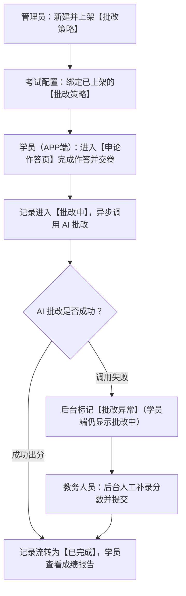

# 双阶段高信噪比标杆示范

本文件提供两组标准示范：
1. **Stage 1 示范**：收到原型/纪要后，如何一针见血审出逻辑漏洞并给出带建议的确认单（不堆砌琐碎问题）；
2. **Stage 2 示范**：方案确认后，如何输出「UI、前端、后端与 Coding Agent 均清晰可读」的干净 PRD 片段（涵盖全局全景、管理后台列表页、APP 端交互页）。

> 注：以下业务细节均为教学演示构建，实际撰写时严格以用户提供的真实业务材料与确认结论为准。

---

## 示范一：Stage 1 原型逻辑体检与方案确认单

**【模拟用户输入】**
> 我画了“AI 申论批改”功能的草图：管理后台有个“批改策略列表”可以新建、编辑、上下架、删除批改方案；配置考试时关联批改策略。学员在 APP 端进入作答页面，支持文字、拍照上传图片（最多5张，单张7M内）、语音作答，可以切换作答方式，答完点交卷后调 AI 批改出分。你帮我写一下 PRD。

**【Stage 1 标准输出示范】**

我已梳理完「AI 申论批改」的核心链路，本次需求涉及 **2 个端（管理后台、APP 端）**，主线为：管理后台维护批改策略并绑定考试 ➔ 学员在 APP 端按策略作答交卷 ➔ 系统调用 AI 批改并产出成绩。

在正式生成结构化 PRD 前，发现原型草图存在 **4 处关键逻辑断点与命名分歧**，请确认以下处理方案（可直接回复“按建议执行”或指定修改项）：

1. **命名统一确认**：草图中同时出现了「批改方案」与「批改策略」两种叫法。
   - **[产品建议]**：全文统一锁死标准名为 **「批改策略」**（对应后台页面：`批改策略列表页`、`新建/编辑批改策略页`）。
2. **策略被占用时的下架与编辑边界（防线上事故）**：当某条「已上架」策略正被未开始或进行中的考试引用时，点击下架或编辑如何处理？
   - **[产品建议]**：采用**硬拦截 + 历史快照隔离**——若存在关联的“未开始/进行中”考试，点击`下架`弹窗阻断并提示关联的考试名称；`已下架`且有历史考试记录的策略禁止直接修改参数（引导使用`复制`生成新策略），确保历史成绩批改口径不被篡改。
3. **APP 端切换作答方式与中途退出的防误触保护**：学员已输入文字或上传图片后，若切换作答方式（如从“文本”切为“图片”）或点击左上角返回，原内容如何处理？
   - **[产品建议]**：① 已有作答内容时切换作答方式，弹窗确认`“切换作答方式将清空当前题目已填写的内容，确认切换吗？”`，确认后清空切换；② 未交卷点击返回时，自动保留最近一次保存草稿并提示确认离开，再次进入可继续作答。
4. **AI 批改异步等待与失败兜底闭环（跨端权责）**：申论 AI 批改耗时较长且可能调用失败，交卷后学员端展示什么状态？若 AI 批改失败由谁兜底？
   - **[产品建议]**：考试记录状态设为 `未开始`、`作答中`、`批改中`、`已完成` 四态。交卷后进入`批改中`（学员可离开页面，出分后更新为`已完成`）；若 AI 重试后仍失败，后台将该记录标记为`批改异常`推送至教务后台人工补录分数，对学员端仍保持展示`批改中`（不把底层 AI 报错暴露给学员）。

确认以上 4 点后，我将立即为你输出完整的正式 PRD。

---

## 示范二：Stage 2 正式 PRD 标杆片段（节选核心章节）

# AI 申论批改模块 产品需求文档

# 一、文档信息与背景范围

| 项目 | 内容 |
| :--- | :--- |
| 文档版本 | V1.0 |
| 文档状态 | 评审中 |
| 更新日期 | 2026-11-26 |
| 产品负责人 | 待补充 |
| 涉及团队 | 产品 / UI / 前端 / 后端 / 测试 |
| 原型 / UI 链接 | 待补充 |

**版本修改记录**

| 版本号 | 修改日期 | 修改内容与涉及章节 | 修改人 |
| :--- | :--- | :--- | :--- |
| V1.0 | 2026-11-26 | 初始创建管理后台批改策略与 APP 端作答批改全流程需求 | 待补充 |

**项目背景与范围**

- **需求背景**：解决申论主观题依赖纯人工阅卷耗时长、反馈慢的问题，引入可配置的 AI 批改策略支撑自动化出分。
- **本次范围**：管理后台「批改策略」增删改查与上下架管控；APP 端主观题多模态作答（文本/图片/语音）、交卷触发 AI 批改及教务异常人工兜底。
- **不在本次范围**：客观题判分逻辑改动、AI 大模型底层提示词调优后台。

---

# 二、全局业务流程与多端全景

## 2.1 核心业务流程图

## 2.2 核心术语与全局状态字典

**核心角色与术语定义**

| 标准名称 | 职责边界或业务定义 |
| :--- | :--- |
| 批改策略 | 定义主观题允许的作答方式与评分维度的配置实体（全文禁用“批改方案”等同义词） |
| 管理员 | 负责管理后台「批改策略」的创建、编辑、上下架与删除 |
| 教务人员 | 负责处理 AI 批改失败转入人工兜底的异常记录 |

**全局核心状态流转表（学员作答记录状态）**

| 状态枚举值 | 业务含义与各端展示表现 | 流转规则（触发动作 → 下一状态） | 角色操作权限与跨端数据影响 |
| :--- | :--- | :--- | :--- |
| 未开始 | 考试未到开放时间或学员尚未进入作答 | 学员首次进入作答页 → `作答中` | 学员端未到时间置灰`开始作答`；到点可点击进入 |
| 作答中 | 学员已进入作答且尚未交卷 | 学员主动交卷或倒计时归零强制交卷 → `批改中` | 学员可继续作答；支持每 15 秒自动保存草稿 |
| 批改中 | 已交卷，等待结果产出；APP端统一显示`批改中`（成绩显示`--`） | AI 成功出分 → `已完成`；AI 失败 → 后台子状态标记`批改异常` | 学员仅可查看已交答卷不可修改；`批改异常`时教务可人工录分，提交后转`已完成` |
| 已完成 | 分数与批改解析已生成（终态） | 终态，无后续流转 | 学员端开放`查看报告`展示真实得分；后台归档保留快照 |

## 2.3 涉及端口与页面路由总表

| 所属端口 | 页面标准名称 | 来源页面及触发入口 | 核心定位与跳转去向 |
| :--- | :--- | :--- | :--- |
| 管理后台 | 批改策略列表页 | 左侧菜单 `营销打卡 > AI考试 > 批改策略` | 查询、上下架、复制与删除策略；可去向 `新建/编辑批改策略页` |
| 管理后台 | 新建/编辑批改策略页 | `批改策略列表页` 点击 `新建` / `编辑` / `复制` | 维护策略规则参数；保存或取消后返回 `批改策略列表页` |
| APP端 | 申论作答页 | `考试详情页` 点击 `开始作答` / `继续作答` | 完成文本/图片/语音作答与交卷；交卷成功后跳转 `考试结果页` |

---

# 三、管理后台

## 3.1 批改策略列表页

- **页面来源**：左侧菜单 `营销打卡 > AI考试 > 批改策略`。
- **页面定位**：统一维护可供考试绑定的 AI 批改策略及其可用状态。
- **数据范围与默认排序**：具备菜单权限的管理员可见全量策略；默认按 `创建时间` 倒序排列。

### 3.1.1 筛选查询与顶部操作

| 筛选项 | 控件类型 | 匹配方式与选项来源 | 默认值与特殊规则 |
| :--- | :--- | :--- | :--- |
| 策略搜索 | 文本输入框 | 输入`批改策略ID`精确匹配，或输入`批改策略名称`全模糊匹配 | 默认为空 |
| 策略状态 | 下拉单选 | 枚举：`全部`、`已上架`、`已下架` | 默认 `全部` |

- **新建策略**：页面右上角主按钮，点击跳转 `新建/编辑批改策略页`（空白初始表单）。

### 3.1.2 列表字段说明

| 字段名 | 数据来源 / 计算口径 | 展示格式与特殊交互 |
| :--- | :--- | :--- |
| 批改策略ID | 保存新建策略时系统自动生成 | 格式 `PG + 月日 + 3位当日递增序号`（如 `PG1126001`） |
| 批改策略名称 | 取自 `新建/编辑批改策略页` 填写的策略名称 | 超 15 字截断省略，鼠标悬停气泡展示全称 |
| 适用考试类型 | 取自策略配置的考试大类与子类 | 格式 `大类-子类`（如 `遴选-笔试`、`公考-申论`） |
| 关联考试ID | 当前绑定了本策略的全部考试配置 ID | 多个以英文逗号分隔；无关联时显示 `--` |
| 创建人 | 创建本条策略的管理员姓名 | 常规展示 |
| 创建时间 | 本条策略首次保存成功的时间 | 常规展示 |
| 策略状态 | 控制本策略是否允许被新考试选择绑定 | 枚举：`已上架`（新建保存后默认状态）、`已下架` |
| 操作 | 当前行可执行管理动作 | 按`策略状态`动态展示按钮，规则见 `3.1.3` |

### 3.1.3 行内操作与状态/弹窗规则

- **下架**：仅 `策略状态 = 已上架` 时显示。
  - **前置占用校验**：点击时校验本策略是否被处于`未开始`或`进行中`的考试关联。若存在占用，阻断下架并弹窗提示 `“当前策略正被考试【{关联考试ID}】使用中，无法下架”` `[建议文案]`（仅提供 `“知道了”` 按钮）。
  - **确认弹窗**：无占用时弹出确认框——标题 `“下架批改策略”`，正文 `“下架后新创建的考试将无法选择该策略，确认下架【{批改策略名称}】吗？”` `[建议文案]`，按钮 `“取消”` / `“确认下架”`。
  - **确认结果**：状态变更为 `已下架`，刷新当前列表；历史已完成考试不受影响。
- **上架**：仅 `策略状态 = 已下架` 时显示；点击后状态直接变更为 `已上架` 并 Toast 提示 `“上架成功”`，后续新建考试可重新选择本策略。
- **编辑**：
  - `已上架` 或 `已下架且无历史关联考试` 时，点击跳转 `新建/编辑批改策略页` 并回填当前数据。
  - `已下架且存在历史关联考试` 时，点击拦截并提示 `“该策略已有历史考试数据，禁止直接修改参数，请使用【复制】创建新策略”` `[建议文案]`。
- **复制**：所有状态下均显示；点击跳转 `新建/编辑批改策略页`，回填原策略全部配置参数，`批改策略ID` 留空待保存生成，`批改策略名称` 默认填充为 `“{原名称}-副本”`。
- **删除**：仅 `策略状态 = 已下架` 且 `关联考试ID` 为空（无任何历史及当前关联）时显示；点击弹出确认框（标题 `“删除确认”`，正文 `“删除后不可恢复，确认删除策略【{批改策略名称}】吗？”` `[建议文案]`，按钮 `“取消”` / `“确认删除”`），确认后移除该记录。

---

# 四、APP 端

## 4.1 申论作答页

- **页面来源**：从 `考试详情页` 点击 `开始作答` 或 `继续作答` 进入（携带 `考试ID`）。
- **页面定位**：供学员浏览申论材料与题干、按允许方式完成作答并交卷。
- **前置拦截条件**：进入时校验该场考试记录状态——若已处于 `批改中` 或 `已完成`，直接重定向至 `考试结果页`，禁止重复进入编辑。
- **页面去向**：交卷成功后跳转 `考试结果页`。

### 4.1.1 顶部栏与题干区

- **返回按钮**：点击弹出离开确认框（标题 `“离开作答”`，正文 `“当前尚未交卷，已保存的作答内容将为您保留，确认离开吗？”` `[建议文案]`，按钮 `“继续作答”` / `“确认离开”`）；确认后触发一次实时草稿保存并返回 `考试详情页`。
- **倒计时**：取自【管理后台 - 考试配置页】设定的「考试时长」，按 `HH:mm:ss` 倒数；归零时弹出 Toast `“考试时间已结束，系统自动为您交卷”` 并强制提交当前全部作答，流转至 `批改中` 并跳转 `考试结果页`。
- **答题进度与题号切换栏**：展示 `已答小题数 / 总小题数`；题号圆点支持 `当前题`、`已作答`、`未作答`、`重点标记` 视觉叠加（切换当前题不覆盖已有的`重点标记`角标），点击题号切换至对应小题。
- **题干与给定材料区**：展示当前小题分值、题干要求与阅读材料；材料区独立上下滚动，不影响底部作答区固定操作。

### 4.1.2 多模态作答与提交区

- **作答方式切换器**：可选方式（`文本` / `拍照图片` / `语音`）取自关联的 `【管理后台 - 3.2 新建/编辑批改策略页】` 配置的 `「允许作答方式」` 字段（后台仅勾选一种时不显示切换器）。
  - **切换保护交互**：当前小题无作答内容时点击直接切换；当前小题已有输入/上传内容时，点击弹出确认框（标题 `“切换作答方式”`，正文 `“切换后将清空本题已填写的作答内容且不可恢复，确认切换吗？”` `[建议文案]`，按钮 `“取消”` / `“确认切换”`），确认后清空本题原数据并切换组件。
- **文本作答框**：多行文本输入并实时展示 `已输入字数 / 5000`；达到 5000 字上限后截断禁止继续输入。
- **拍照图片上传区**：单题最多上传 5 张（达 5 张后隐藏 `+` 上传入口），支持点击大图预览、单张删除与拖拽排序。
  - **大小超限拦截**：客户端压缩后单张仍超过 7MB 时，拦截不予上传并 Toast 提示 `“上传图片不能超过 7M”`。
- **语音作答组件**：点击开始录制并展示动态计时，最长 5 分钟（满 5 分钟自动停止录制并保存音频条）；支持试听与删除重录。
- **自动保存机制**：停留本页期间，作答内容发生变更后每 15 秒静默自动保存一次草稿。
- **提交试卷按钮**：
  - **点击校验与差异化弹窗**：
    - 若全部小题均已作答：弹出确认框（标题 `“确认交卷”`，正文 `“交卷后将无法修改答案，确认立即交卷吗？”` `[建议文案]`，按钮 `“再检查下”` / `“确认交卷”`）；
    - 若存在未作答小题：弹出强提示确认框（标题 `“存在未作答题目”`，正文 `“您还有 {未答数} 道小题未作答，确认直接交卷吗？”` `[建议文案]`，按钮 `“继续作答”` / `“仍要交卷”`）。
  - **未完成上传拦截**：点击交卷时若有图片或语音仍处于上传中，拦截并 Toast 提示 `“第 {题号} 题附件正在上传中，请稍候提交”`；若有附件上传失败，定位提示对应题号重新上传，保持 `作答中` 状态。
  - **确认交卷结果**：记录状态流转为 `批改中`，锁定答卷不可再改，异步触发 AI 批改任务，页面跳转至 `考试结果页`。
