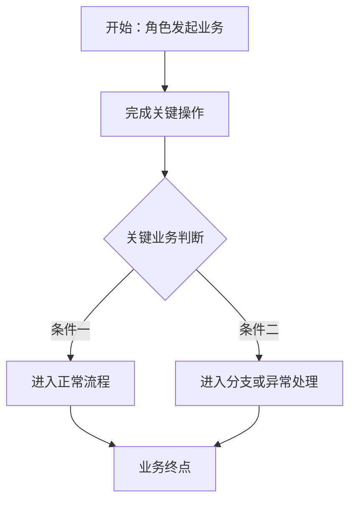

# [项目 / 模块名称]需求文档 [Vx.x]

# 文档信息

| 项目 | 内容 |
| --- | --- |
| 文档版本 | [Vx.x] |
| 文档状态 | [草稿 / 评审中 / 已确认] |
| 创建时间 | [YYYY-MM-DD / 待补充] |
| 最近更新时间 | [YYYY-MM-DD / 待补充] |
| 产品负责人 | [姓名 / 待补充] |
| 涉及人员与职责 | [业务 / 产品 / UI / 开发 / 测试] |
| UI / 原型地址 | [链接 / 待补充；全文只保留一次] |
| 关联文档 | [文档名 + 版本 / 章节链接] |

**版本记录**

| 版本 | 更改时间 | 更改内容 | 更改人 |
| --- | --- | --- | --- |
| [Vx.x] | [日期] | [本次变更摘要] | [姓名] |

# 背景与范围

- **背景**：用一至两句话说明为什么做。
- **本次范围**：说明本次实现的业务能力。
- **不在本次范围**：只列容易误解为本次包含的事项。
- **涉及角色**：[角色及职责]。
- **涉及端**：[网页端 / APP 端 / 小程序端 / 管理后台 / 教师后台]。

# 角色与专业词汇

仅在存在多角色分工、项目自定义词或易混淆词时保留本章节。

| 词汇 / 角色 | 定义 / 职责 |
| --- | --- |
| [词汇或角色] | [一句话定义] |

# 业务流程

[正式文档中插入实际可见的主流程图；多角色使用泳道图或按角色拆图。以下为 Mermaid 起始结构，需替换为真实业务。]

# 全局规则

仅在规则确实跨多个页面时保留；否则删除本章节，把规则写到对应元素下。

- **[全局状态 / 权限 / 数据口径]**：[适用范围 + 具体规则 + 影响]。

# 一、[业务模块 / 端名称]

## 1.1 [列表页名称]

- **页面来源**：[上一级页面 + 入口元素]；返回[目标页面]。
- **页面定位**：[一句话说明页面任务]。
- **权限 / 前置条件**：[有则填写，无则删除本行]。

### 1.1.1 页面加载与查询

- **数据范围**：[展示哪些数据，是否受角色权限影响]。
- **默认排序**：[字段 + 升序 / 倒序；无特殊规则则明确说明]。
- **搜索 / 筛选**：[支持的字段、匹配方式、清空与重置规则]。
- **新建按钮**：点击后进入[1.2 页面名称]，[是否携带默认值]。

### 1.1.2 列表字段与显示规则

- **[字段一]**：[含义或数据来源]；[格式 / 空值 / 特殊规则]。
- **[字段二]**：展示[对应信息]，无特殊规则。
- **状态**：
  - **[状态 A]**：[进入条件、业务含义、可执行操作]。
  - **[状态 B]**：[进入条件、业务含义、可执行操作]。
- **操作**：
  - **[操作 A]**：[显示条件]；点击后[反馈 / 跳转 / 状态或数据变化]。
  - **[操作 B]**：[显示条件]；点击后[反馈 / 跳转 / 状态或数据变化]。

## 1.2 [新建 / 编辑页面名称]

- **页面来源**：从[1.1 列表页]点击[新建 / 编辑]进入；取消后返回[目标页面]。
- **页面定位**：完成[配置或提交任务]。
- **新建与编辑差异**：[初始值、可编辑范围、校验差异；无差异则写“除数据回填外一致”]。

### 1.2.1 [表单区域名称]

- **[字段 / 元素]**：[输入或展示规则]。
  - **显示条件**：[有动态显隐时填写]。
  - **校验与反馈**：[触发时机 + 结果 + 提示]。
  - **交互影响**：[切换、选择或输入后对其他字段 / 数据的影响]。
- **[普通字段]**：[含义或来源]，无特殊规则。

### 1.2.2 底部操作

- **取消**：点击后返回[页面]，[未保存数据如何处理]。
- **保存**：点击后校验[关键规则]；成功后[状态、数据与页面去向]；失败时[业务反馈]。

# 二、[下一业务模块 / 端名称]

## 2.1 [页面名称]

- **页面来源**：[入口与返回关系]。
- **页面定位**：[一句话说明页面任务]。

### 2.1.1 [区域名称]

- **[元素]**：[展示 / 输入规则]；点击后[交互结果]。
- **[状态]**：
  - **触发**：[条件]。
  - **表现**：[页面和按钮状态]。
  - **去向**：[成功 / 失败 / 人工处理后的状态]。
  - **影响**：[历史数据、其他页面、其他角色或其他端]。

# 业务异常处理

仅保留本次实际存在的业务异常；通用网络异常和并发问题不在此展开。

## [编号] [异常场景名称]

- **触发条件**：[业务步骤 + 失败结果]。
- **业务状态**：[对象进入的状态]。
- **用户反馈**：[页面、提示和可操作项]。
- **后续处理**：[自动重试 / 人工处理 / 重新操作]。
- **数据与权责**：[数据保留、通知对象、处理责任人、处理后的去向]。

# 待确认清单

没有待确认项时删除本章节。

| 编号 | 待确认事项 | 负责人 | 影响范围 | 当前文档位置 |
| --- | --- | --- | --- | --- |
| 1 | [事项] | [姓名 / 角色 / 待补充] | [页面 / 字段 / 流程] | [章节号] |
